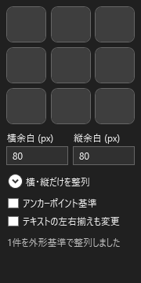

# YmmTextAlign — テキスト整列

ゆっくりMovieMaker4（YMM4）で、選択したテキストをワンクリックで配置するプラグインです。
画面の左上・中央・右下など9方向への配置に加え、横方向だけ・縦方向だけの整列もできます。

## 対応環境

- Windows 64bit
- YMM4 **4.53.0.1** を使用した検証を行っています。v4.56.1.0(10月12日付の最新バージョン)動作確認ができており、その他バージョンでの動作は未確認です。
- プラグインのバージョン：**0.3.0**

v0.3.0は描画処理の自動検証を行っていますが、YMM4本体の画面での手動動作確認は未実施です。

## インストール

1. 配布ファイルの **`YmmTextAlign.ymme`** をダウンロードします。
2. YMM4を終了します。
3. ダウンロードした `.ymme` ファイルをダブルクリックします。
4. 表示されたプラグインインストーラーの案内に従ってインストールします。複数のYMM4を使っている場合は、導入先を確認してください。
5. YMM4を起動し、**「ツール」→「テキスト整列」** を開きます。

パネルのタイトルに「テキスト整列 v0.3.0」と表示されれば、このバージョンが読み込まれています。

`YmmTextAlign-4.53.0.1.ymme` も同じ内容です。どちらか一方をインストールしてください。
`YmmTextAlign-source.zip` は開発用のソースコードで、通常のインストールには不要です。

### ダブルクリックしてもインストーラーが開かない場合

YMM4を起動し、**「ヘルプ」→「YMM4用拡張子の関連付け」→「登録する」** を実行してください。
その後、YMM4を終了して `.ymme` ファイルをもう一度ダブルクリックします。

詳しくは [YMM4公式のプラグイン導入ガイド](https://manjubox.net/ymm4/faq/plugin/how_to_use/) を参照してください。

## 使い方

1. タイムラインで整列したい**テキストアイテム**を選択します。複数選択にも対応しています。
2. 再生位置を、文字が表示されているフレームに合わせます。
3. 「横余白」「縦余白」を必要に応じて入力します。
4. 3×3のボタンから、配置したい位置をクリックします。

ボタンの位置と整列方向は次の対応です。ボタン自体には文字やアイコンを表示しません。

ボタンは通常ダークグレーで、マウスを重ねている間だけ青色になります。
マウスを重ねると、整列方向の説明も表示されます。
小さなパネルでも利用でき、高さが足りない場合はスクロールできます。

整列後はパネル下部に結果が表示されます。
操作を取り消す場合は、YMM4の「元に戻す」を使ってください。「やり直す」にも対応しています。

**複数のテキストは、それぞれを同じ指定位置に整列します。互いの間隔を保って並べる機能ではないため、重なる場合があります。**

### 横方向・縦方向だけを揃える

**「横・縦だけを整列」** を開いて、目的のボタンを押してください。

- 「左」「横中央」「右」：X座標だけを変更します。
- 「上」「縦中央」「下」：Y座標だけを変更します。

カメラなどの映像エフェクトによっては、片方の座標を変更しても画面上では縦横両方の位置が変わる場合があります。

## 設定

### 横余白・縦余白

画面端からの余白をピクセル単位で指定します。初期値はどちらも **80px** です。
0以上で、対応する画面の幅・高さの半分未満の値を入力してください。

例：右下に配置する場合、横余白は右端から、縦余白は下端からの距離になります。
中央配置では画面の中央に揃え、余白は文字が収まる範囲として使います。

### アンカーポイント基準

初期値は **OFF** です。見た目の端を揃えたい場合はOFFで使用してください。

| 設定 | 動作 |
| --- | --- |
| OFF | 文字全体と適用中の映像エフェクトの描画範囲を基準に、端または中央を揃えます。複数行の文字もまとめて扱います。 |
| ON | アイテムの中心位置（X/Y）を基準に配置します。描画範囲が余白の外に出る場合は、内側へ補正します。 |

このオプションは座標計算の基準を切り替えるものです。アンカーポイントや「中心位置」エフェクトの設定自体は変更しません。

### テキストの左右揃えも変更

初期値は **OFF** です。

| 設定 | 動作 |
| --- | --- |
| OFF | テキスト内部の左揃え・中央揃え・右揃えを維持したまま、アイテムを移動します。 |
| ON | 横方向の配置に合わせて、テキスト内部の左右揃えも変更します。複数行の文章を左・中央・右に揃えたいときに使います。 |

縦方向の基準点は維持します。縦方向だけを整列する操作や、縦書きテキストでは、内部の左右揃えを変更しません。

## 映像エフェクト・アニメーションについて

文字の縁取りや影に加え、テキストアイテムに追加した映像エフェクトも適用後の描画範囲を測定して整列します。
エフェクトの設定値・順序・有効／無効は維持します。

ただし、すべてのエフェクトや外部プラグインの組み合わせを確認したわけではありません。
描画範囲を取得できない場合や、座標を変えても表示位置が動かない場合などは、そのアイテムを変更せず、パネル下部に理由を表示します。

アニメーションがある場合は、現在の再生位置で整列します。再生位置がアイテムの外にある場合は、先頭フレームを使います。
位置アニメーションの各点に同じ移動量を加えるため、移動の相対的な形は維持します。
**別のフレームでの見切れは防げないため、再生して配置を確認してください。**

### 現在の制限

- ロックされたアイテムは変更しません。
- 文字やエフェクトの大きさを自動で縮める機能はありません。余白内に収まらない場合は整列できません。
- 一文字ずつの表示・消去、個別文字描画、文字ごとの時間オフセット、他のオブジェクトによるクリッピングは未対応です。
- グループや親シーンなど、テキストアイテムの外から加わるエフェクト・変形は考慮しません。
- エフェクトの余白や透明部分も描画範囲に含まれる場合があるため、目に見える文字の端と完全には一致しないことがあります。
- 初回やエフェクトが多い場合は、整列に時間がかかることがあります。

## うまく動かない場合

| 症状 | 確認すること |
| --- | --- |
| 「テキスト整列」がツールメニューにない | 導入先のYMM4が正しいか確認し、YMM4を再起動してください。 |
| 古いバージョンのパネルが開く | YMM4を終了して新しい `.ymme` を再インストールし、起動し直してください。 |
| 「編集可能なテキストを選択してください」と表示される | テキストアイテムを選択し、ロックされていないか確認してください。 |
| 余白のエラーが出る | 余白を0以上、画面の幅・高さの半分未満にしてください。 |
| 「変更しませんでした」と表示される | 続けて表示される理由を確認してください。文字のサイズ・余白・エフェクトの設定を見直してください。 |

問題を報告するときは、YMM4とプラグインのバージョン、押した整列ボタン、チェックボックスの状態、パネル下部のメッセージを添えてください。
使用している映像エフェクトの名前や設定もあると、原因を調べやすくなります。

## アンインストール

1. YMM4を終了します。
2. 使用しているYMM4のフォルダーを開きます。
3. `user\plugin` 内の **YmmTextAlign専用フォルダー**（通常は `YmmTextAlign`）を削除します。
4. YMM4を起動し直します。

導入後にYMM4が起動しなくなった場合も、この方法でプラグインを取り外してください。
